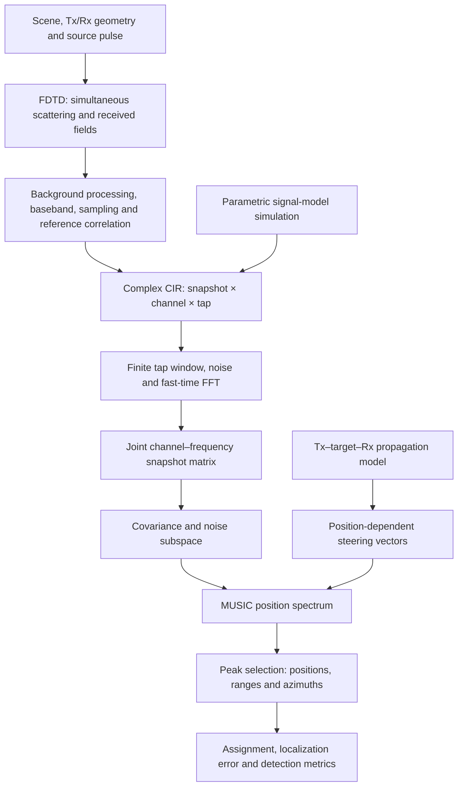

# Single-anchor IR-UWB radar: FDTD simulation, CIR processing and JSF-MUSIC

Materials for **CIR-Based Joint Range–Azimuth Localization for Single-Anchor IR-UWB Radar: Implementation and Validation**, by Shangyou Zeng and Lin Sun. Revision release: `revision-20261016`.

This platform connects electromagnetic simulation, channel impulse response (CIR) processing and multi-target localization for single-anchor impulse radio ultra-wideband (IR-UWB) radar. Its finite-difference time-domain (FDTD) front end computes the fields scattered by multiple targets and converts the received waveforms to complex CIR. Joint space–frequency multiple signal classification (JSF-MUSIC) combines CIR frequency samples with physical transmit–target–receive geometry to estimate positions, ranges and azimuths.

A fast Fourier transform (FFT) across CIR taps supplies the frequency samples used by the joint estimator.

The release contains the simulation code, selected original field records, all formal simulation CIR sequences and saved results, and the complete **205 evaluation segments** of original chip-recorded hardware CIR. It now also includes continuous-background preprocessing state, the six hardware estimator implementations, twenty ablation settings, repeated-measurement evaluation, and the expanded fixed-5-cm separation analysis. Portable commands regenerate numerical results and figures; see the [manuscript reproduction map](docs/manuscript_reproduction.md).

All localization comparisons supply the target count. The hardware comparison concerns adapted implementations on this dataset; it does not establish general superiority over the published methods. Simulation separation results do not establish measured close-person resolving capability.

## Documentation

| Start here | What it explains |
|---|---|
| **[Data structure and reading examples — data/README.md](data/README.md)** | Organization of simulation CIR, original fields, trial records, spectra, settings and tables; dimensions, units and file relationships |
| **[Original hardware CIR — data/hardware/README.md](data/hardware/README.md)** | The 205 raw segments, eight channels, original complex counts, target truth, recording identifiers and estimated time fields |
| **[中文平台介绍 — README_zh.md](README_zh.md)** | Chinese explanations of the FDTD model, CIR signal, localization algorithm and reproduction commands |
| **[Hardware reproduction](hardware_reproduction/README.md)** | Continuous EMA preprocessing, six methods, twenty ablations, statistics, verification and table regeneration |
| **[Revised separation study](spacing_revision/README.md)** | All 65 fixed-5-cm conditions, 6,500 trials, clean inputs, seeds, failures and plotting commands |
| **[Paper-to-code map](docs/manuscript_reproduction.md)** | Each manuscript experiment, table and figure and its reproduction entry point |

This page explains how the platform works. The data READMEs explain the actual files and arrays to read when using it.

## Platform workflow



Controlled FDTD and parametric simulations share the estimator and evaluation rules. The correspondence experiment uses the measured array geometry to compare simulated and measured position spectra. Original hardware CIR are supplied separately, with their acquisition parameters and channel mapping.

## FDTD simulation

### Scene and electromagnetic solver

The solver uses Meep to compute the electric-field component `Ez` in a two-dimensional x–y domain. The controlled scene contains one transmitter and four receivers. Targets are metal cylindrical scatterers with nominal positions and small bounded movements between slow-time states. All targets are present in the **same field solve**, so the received waveform includes their simultaneous scattering response.

Within each slow-time state, targets remain fixed during the radio frequency (RF) transient. The transmitter emits a pulse and the field is sampled at the receivers. Updating the target positions and solving the next state produces the next observation. The 128-state sequence therefore contains actual state-specific solutions. A separate empty scene provides the controlled experiment's background field.

Perfectly matched layers (PML) absorb outgoing waves at the domain boundary. The domain is resolved from the array, target positions, motion allowance and boundary margins and saved with each scene. The nominal scatterer radius is approximately 0.0563 m. These scatterers define the numerical experiment; measured human-target CIR are stored separately.

The excitation is the time derivative of a Blackman–Harris-windowed carrier. Its duration is `2/B`, or 4 ns at the nominal 500 MHz bandwidth. The source and correlation reference use the same pulse definition. Meep uses a length unit of 1 m and a time unit of `1 m/c0`, where `c0` is the speed of light in vacuum; 20 Meep time units correspond to approximately 66.7 ns.

| Controlled FDTD setting | Value |
|---|---|
| Carrier; nominal bandwidth | 7.9872 GHz; 500 MHz |
| Transmitter | `(0,0,0)` m |
| Receiver x coordinates | −0.038, −0.019, 0 and 0.019 m; y = z = 0 |
| Spatial resolution; Courant factor | 350 cells/m; 0.5 |
| Duration; absorbing-layer thickness | 20 Meep time units; two carrier wavelengths |
| Target motion | Step standard deviation 0.002 m; displacement bound 0.01 m |
| Retained slow-time states | 128 |

The simulation–measurement correspondence uses the horizontal projection of the measured two-transmitter geometry and its selected four transmit–receive pairs. Its background processing uses an exponential moving average (EMA) with coefficient 0.25 and 32 actual startup states before the retained 128 states. Controlled FDTD uses empty-scene field subtraction. Each dataset records its own background and geometry settings.

### Receiver chain: fields to CIR

The real passband field waveform is converted to a complex delay-domain signal through:

1. **Background processing:** subtract the empty-scene field at the same receiver locations for controlled experiments.
2. **Complex baseband conversion:** form the analytic signal with a Hilbert transform, then multiply by `exp(-j*2*pi*fc*t)`.
3. **Antialiasing and sampling:** apply the explicit baseband frequency cutoff and resample at the CIR tap times. The reference pulse follows the same conversion and sampling chain.
4. **Reference correlation:** correlate with the conjugate-reversed reference pulse and remove the known filter lag to align the delay axis.
5. **Finite CIR storage:** retain 32 complex taps per channel and state. Correspondence simulations additionally apply the state-domain EMA and discard its startup states.

At a 1 ns tap interval, the CIR sampling rate is 1 GHz. The configured antialias cutoff is 400 MHz. This receiver cutoff is separate from the nominal 500 MHz operating bandwidth and the subsequent ±250 MHz frequency-bin selection. The actual excitation/reference spectrum is saved in `data/settings/source_pulse_spectrum.*`.

Implementation: [solver.py](src/fdtd/solver.py), [pulse.py](src/fdtd/pulse.py), [rf_chain.py](src/fdtd/rf_chain.py) and [api.py](src/fdtd/api.py). Scene settings and trajectories are described in **[data/README.md](data/README.md)**.

## CIR signal and observation matrix

A complex CIR records the delay-dependent in-phase and quadrature (I/Q) response of one transmit–receive channel. The three array axes have different roles:

| Axis | Meaning |
|---|---|
| **Fast time / tap** | Samples along propagation delay within one CIR; used for the frequency transform |
| **Channel** | A physical transmitter–receiver pair; used for spatial phase differences |
| **Slow time / snapshot** | Successive observations or simulated states; used for covariance estimation |

The controlled numerical CIR has shape `[L,C,T] = [128,4,32]`. Original hardware CIR have shape `[128,8,32]`, retain the chip's original integer I/Q values, and include all eight pairs. The manuscript's four channels are selected with `selected_pair_indices = [2,3,6,7]`. The two signals have different origins and amplitude conventions, as their data guides explain.

Controlled estimator input is constructed as follows:

```text
Numerical CIR                [L,C,32]
Retain taps [0:30]            [L,C,30]
Add complex CIR noise        [L,C,30]
Fast-time FFT, length 32      [L,C,32]
Select 17 in-band bins        [L,C,F]
Stack frequency then channel [L,F*C]
```

The physical frequency axis is `fc + np.fft.fftfreq(32,d=1e-9)`. The 17 bins within `fc ± 250 MHz` retain their original FFT-index order, including the wrapped negative-baseband portion. Steering entries use the corresponding physical frequencies.

`X` stores one snapshot per row and one channel–frequency feature per column. Feature `f*C+q` corresponds to frequency `f` and channel `q`. The reference configuration gives `X.shape = [128,68]` and a `[68,68]` covariance. The manuscript's `[68,L]` matrix uses column snapshots; the code stores snapshots as rows.

Noise is added to the background-processed finite CIR window before the FFT. Clean sequences and noise seeds are stored separately. Changing SNR scales a matched noise realization, while changing snapshot count takes genuine prefixes of the same clean and noise sequences.

The hardware directory preserves raw samples. Its metadata describe the recording-level EMA, historical hardware tap window `[2:32]` and channel calibration. The numerical window `[0:30]` above belongs to controlled simulation input.

Implementation: [data.py](src/exec2/jsfsim/data.py) and [sim_common.py](src/sim_common.py). Array keys, dtypes, units and reading examples are in **[data/README.md](data/README.md)** and **[data/hardware/README.md](data/hardware/README.md)**.

## JSF-MUSIC localization algorithm

JSF-MUSIC uses the established MUSIC subspace criterion with a joint channel–frequency observation vector and a position-dependent radar propagation model. Frequency-dependent phase carries delay information; phase differences between transmit–receive channels carry spatial information. Their joint use gives a position spectrum from which range and azimuth are obtained.

### Covariance and noise subspace

For `X` of shape `[L,M]`, where `M=F*C`, the row-snapshot implementation computes:

```python
R = X.conj().T @ X / L
```

The reference configuration applies forward–backward covariance averaging, then adds `epsilon*trace(R)*I` as diagonal loading, with `epsilon=1e-5`. An eigendecomposition sorts eigenvalues in ascending order. Given the supplied target count `K`, the eigenvectors for the smallest `M-K` eigenvalues form the noise subspace `En`, of shape `[M,M-K]`. Covariance construction, averaging, loading and eigendecomposition use standard processing steps.

### Geometry-dependent steering and position spectrum

For candidate `p=(x,y,0)` and channel `q`, propagation delay and the steering entry are:

```text
tau_q(p) = (||p-tx_q|| + ||p-rx_q||)/v + tau_sys
a_fq(p)  = exp(-j*2*pi*f_f*tau_q(p))
```

`tx_q` and `rx_q` are the channel's physical coordinates, `v` is propagation speed, and `tau_sys` is the configured system delay. Entries are flattened in the same frequency-major/channel-minor order as `X`. The estimator adopts a unit effective response in this phase model.

Writing `a(p)` as a **row**, consistent with the stored observations, the implemented MUSIC position spectrum is:

```text
P(p) = 1 / (Re{a(p) En Enᴴ a(p)ᴴ} + delta)
```

The implementation uses the numerical denominator floor `delta=1e-12` and evaluates the response over the valid position grid. A candidate whose steering vector has a small projection onto the noise subspace produces a large spectrum response.

### Peak selection and output

Local maxima use a `3×3` neighborhood, eight-connected plateau handling, a 0.30 relative response threshold and a minimum peak separation of 0.10 m. At most `K` estimates are returned; fewer outputs remain possible when peaks do not pass the rule.

Each peak gives `(x,y)` in metres. With the repository's forward-axis convention:

```text
range   = sqrt(x*x + y*y)
azimuth = atan2(x,-y)        # reported in degrees
```

The controlled scan uses a 5 cm grid over `x ∈ [-2.2,2.2] m`, `y ∈ [-3.2,-0.55] m`. The measured-geometry comparison extends y to `[-4.2,-0.55] m`. Target count is supplied; these experiments evaluate localization and target recovery.

Implementation: [estimate.py](src/exec2/jsfsim/estimate.py), [q6_methods_this_method.py](src/vendor/common/q6_methods_this_method.py), [case_build.py](src/adapter/case_build.py) and [peaks.py](src/vendor/knownk_eval/peaks.py). Ground-truth coordinates are separate evaluation inputs and are not passed into the estimator.

## Parametric model and experiment coverage

The controlled parametric model generates channel–frequency responses from transmit–target–receive delays, unit path amplitudes and independent uniform target phases across snapshots. A 500 MHz spectral mask precedes the inverse FFT that creates its numerical CIR. The finite window, noise, FFT and estimator then follow the same path as controlled FDTD.

The separate correspondence reference uses plane-wave array phases, radar reference delay, flat effective response and twenty fixed-seed realizations per configuration. It directly generates frequency-domain snapshots. It is a data-generation reference, not execution of the Deng localization estimator.

| Experiment | Question examined |
|---|---|
| Localization and SNR | Error and recovery across single-, two- and three-target layouts as CIR noise changes |
| Target separation | Accurate two-target resolution for transverse, radial and oblique pairs |
| Snapshot count | How genuine prefixes `L=10,16,32,64,128` change covariance support and localization |
| Simulation–measurement correspondence | Position-spectrum agreement for fifteen configurations and 205 measured segments |
| Original hardware dataset | Recorded CIR, truth and acquisition settings underlying the manuscript evaluation |

The six controlled groups retain all 24,150 formal trial records. Evaluation uses one-to-one position/range/azimuth assignments, a separate 0.30 m detection match and the stricter `min(0.10 m,separation/3)` two-target-resolution gate. See **[data/README.md](data/README.md)** for group sizes, record fields, final-table selection and SNR-label conversion.

## Contents

| Path | Contents |
|---|---|
| `src/fdtd/` | Meep solver, simultaneous-target scenes, receiver chain, background processing and CIR construction |
| `src/analytic/` | Parametric signal-model CIR generation |
| `src/exec2/jsfsim/` | Final simulation layouts, deterministic seeds, noise, estimation and metrics |
| `src/vendor/` | Frozen estimator dependencies used by the simulation package |
| `data/cache/` | 14 FDTD and 29 parametric clean CIR sequences, with independent truth and settings |
| `data/field_samples/` | Six original solver records: empty scene and nominal target state for S1, S2 and S5 |
| `data/results/runs/` | All 24,150 saved formal simulation trial records, task definitions and fixed spectrum examples |
| `data/q4/` | Simulation–measurement correspondence inputs, saved spectra, fixed-seed reference results and summaries |
| `data/hardware/` | Exactly 205 raw, unprocessed hardware CIR segments and acquisition metadata |
| `data/settings/` | Effective protocol, recorded environment and source-pulse reference |
| `data/tables/` | Final numerical tables and manuscript SNR labels |

The large collection of intermediate FDTD field states is represented by fixed examples rather than copied in full. All 128-snapshot controlled CIR sequences are included. Missing intermediate field states can be regenerated with Meep.

## Environment

Saved-data checks, plots and estimator replay need Python, NumPy, SciPy and Matplotlib:

```bash
python -m pip install -r requirements.txt
```

The original remote simulation environment used Python 3.12.11, Meep 1.30.0, NumPy 2.3.0 and SciPy 1.16.0. For FDTD regeneration, use a Linux Conda environment:

```bash
conda env create -f environment.yml
conda activate jsf-music
```

## Reproduction

Run from the repository root. These commands read the released data and leave the original arrays unchanged:

```bash
python reproduce.py verify
python reproduce.py tables --out outputs/tables
python reproduce.py figures --out outputs/figures
python reproduce.py replay --layout S2
python q4_reproduce.py summarize
python q4_reproduce.py replay --config G-420 --trial 0
```

`verify` checks source/data hashes, all clean CIR shapes and the saved assignment/detection metrics for all 24,150 formal records. `tables` recomputes pooled position, range and azimuth RMSE, detection and resolution counts from the saved predictions. `figures` regenerates the three simulation curve figures from the final tables. `replay` regenerates noise and runs JSF-MUSIC for one archived trial, comparing the resulting positions with its saved result. No command above invokes the FDTD solver.

To regenerate one controlled 128-state FDTD scene, choose a new output directory:

```bash
python regenerate_fdtd.py --clean-id cln_de385a3b2982 --out outputs/new_fdtd_S2 --workers 1
```

This command performs actual Meep simulations. `--max-states` can make a shortened demonstration; its output is not the full sequence used in the paper. The archived production settings are 350 cells/m and 20 Meep time units.

## Interpretation and review coverage

The simulation package evaluates JSF-MUSIC. The five external estimators are evaluated on the shared hardware CIR dataset through the released `hardware_reproduction/` pipeline.

| Review item | Released evidence |
|---|---|
| Q1 | Joint channel–frequency observation construction, transmit–target–receive steering and MUSIC implementation |
| Q2–Q3 | All 205 raw hardware CIR segments, segment identifiers, acquisition settings and target truth |
| Q4 | Fifteen simulation configurations, all 205 saved measurement spectra, correspondence records and fixed-seed parametric reference |
| Q5 | Complete controlled simulation records for SNR, directional separation and snapshot sensitivity; archived hardware factor tables |
| Q6 | Raw hardware inputs, continuous EMA initial states and all six estimator implementations in `hardware_reproduction/` |
| Q7 | Simulation source, parameters, seeds, data structures and verified reproduction entry points |

**SNR labels:** historical `snr_db` in the saved run records is a generator parameter. Because the recorded complex-noise scaling gives half of its nominal target noise power, the expected CIR SNR is `snr_db + 10*log10(2)`, approximately `snr_db + 3.0103 dB`. The manuscript and `data/tables/manuscript/` use this expected SNR. Reproduction preserves the executed noise scaling and seeds.

RMSE pools squared errors over all assigned pairs, without a distance gate. Unassigned targets do not enter RMSE. Detection uses a separate 0.30 m one-to-one match; its missed-target count differs from the unassigned-target count. Noise trials reuse their layout's clean sequence, and snapshot tests use genuine prefixes of that sequence.

The provided plotting scripts reproduce the numerical content of the simulation figures; PDF byte identity across environments is not asserted. Arrays and the original numerical source are tracked by SHA-256 in `data/source_manifest.json` and the hardware export index. Internal SSH utilities, credentials and conversation records are excluded.

## Mandatory-corrections reproduction commands

```bash
python spacing_reproduce.py verify
python spacing_reproduce.py figures --out outputs/spacing
python spacing_reproduce.py replay --task E2_B_transverse_d875_snr+10 --trial 1000
python q4_reproduce.py verify-spectra
python q4_reproduce.py replay-fdtd --config all
python q4_figures.py --out outputs/q4
```

The revised separation figure replaces the original sparse separation figure generated by `reproduce.py figures`; SNR and snapshot figures retain the original results. The original 24,150 records remain available for provenance, while the revised fixed-grid separation study has a separate 6,500-record denominator. Do not combine original and revised separation trials.

To regenerate the correspondence FDTD input with Meep, use `python q4_regenerate_fdtd.py --config G-420 --out outputs/new_q4_G420 --workers 1`. This uses the measured horizontal geometry, 32 background startup states and 128 retained states. Saved-data verification and plotting do not run Meep. See `hardware_reproduction/README.md` for hardware commands and `docs/manuscript_reproduction.md` for the complete paper map.
